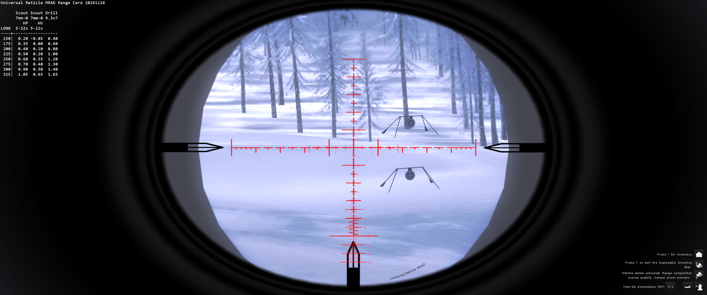

# theHunterClassic_Better_Reticles
Range Cards, Static 2d reticles and Overlay for the Hunter Classic game

Structure: 
<ul>
<li>/Overlay Install - PlayClaw 5 software for testing (no license yet).
<li>/Reticle Templates - Saved screenshots cleaned for initial reticle edition in GIMP.
<li>/Simple Reticles - Oprics reticles with 150-300 range ticks added (max zoom is reference zoom).
<li>/Advanced Reticles - MRAD-like short/long (5-12MRAD vertical) reticle to use with range card.
<li>/Range Cards - YAML file for different weapon setups (caliber + optics), final range card should be compiled from this library. 
</ul>

<h3>Installation</h3>
<ol>
<li>Install Play Claw 5.
<li>Run Play Claw, use trial, or buy license and activate it.</li>
<li>Enter Configuration, setup non-conflicting keybind for enabling/disabling overlay. (ie. Alt+/)
<li>Precompile Range Card for the hunt. Play Claw restricts TXT to 8 lines and 40 chars.
<li>Enter Plugin setup, Image overlay. Browse and choose reticle of your choosing with option (Fully visible, stretch).
<li>When using advanced overlay (Universal Reticle), one can add Range card as Text overlay. Pick Text overlay, tick Text file, choose compiled range card with calibres for this hunt. Set font to Consola 11.
<li>Enter Preview overlays and stretch Image overlay field to fit whole screen. Also setup Text overlay so it does not overlap with reticle field (ie. left top quarter).</li>
<li>Enter the game. The overlay will be already visible in the Launcher dashboard. Disable overlay with hotkey and setup the game.
<li>NOTE: Then swithing to/from game (ie. to change reticle) remember to disable overlay. Game gets unstable otherwise.
</ol>

<h3>Playclaw setup</h3>
<ol>
<li> Run Playclaw 5 (admin privs required), "Skip auto-update" + "Try"</li>
<li> Remove all hotkeys, setup hotkey combination for global overlay (ie. Alt + P)</li>
<li> Enter Plugins </li>
<li> Remember to run Playclaw on screen where the actual game takes place</li>
<li> Remember to set up resolution to 1920x1080, or user defined if playing >HD</li>
<li> While working on overlay preview, user Ctrl + mouse scroll to see whole screen</li>
<li> In Text plugin, setup plugin, point text file sources to hunt/range_card.txt</li>
<li> In Text plugin, preview overlay, setup plugin windows in the left-top corner with size fitting at least 3 columns</li>
<li> In Image plugin, setup plugin, point to source image (reticle of your choosing from proper screen resolution folder), avoid scaling</li>
<li> In Image plugin, preview overlay, setup plugin windows to cover entire screen, it is important no to leave 1-2 px uncovered, as it leads to reticle alignment error</li>
<li> Validate in game proper reticle placement.</li>
</ol>

</img>

